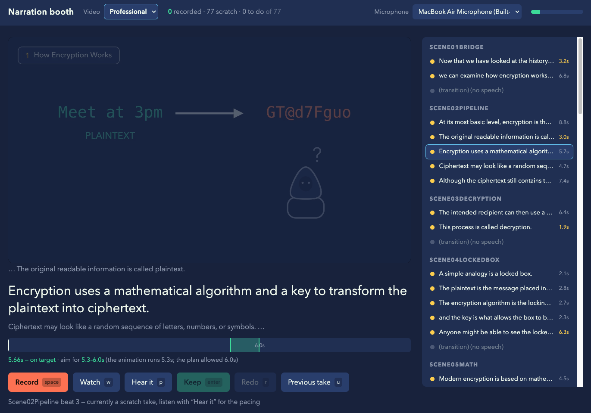

# Encryption videos

An explainer on how encryption works, animated end to end in
[Manim Community](https://www.manim.community/) — no AI-generated footage
anywhere. There are two cuts of it, built from the same plan, the same palette
and the same script:

| | | |
| --- | --- | --- |
| [`ProfessionalVersion/`](ProfessionalVersion) | **animated** — silent cut in `ProfessionalVersion/renders/`, narration still to record; the history intro is still to be written | the full cut: 13 scenes, 77 narrated beats, 8:00 |
| [`SimplifiedVersion/`](SimplifiedVersion) | **done** — the cut is in `SimplifiedVersion/renders/` | the proof of concept: 10 scenes, 46 narrated beats, ~3:28 |

Each version is self-contained: its own scenes, its own narration, its own
renders, its own virtualenv. What they share sits at the root: the recording
booth at [`recorder/`](recorder), which serves both and knows which audio
folder a take belongs in, and the one Manim checkout at `manim/` that both
venvs install from.

```
EncryptionVideos/
├── record.sh              the narration booth, for either version
├── recorder/              the booth itself — see recorder/server.py
├── manim/                 the Manim checkout both venvs install from
├── ProfessionalVersion/   scenes.py, narrate.py, render.sh, audio/, renders/
└── SimplifiedVersion/     the same shape, finished
```

Inside a version:

| Path | What it holds |
| --- | --- |
| `encryption-video-plan.md` | The plan that cut follows. The source of truth. |
| `scenes.py` | Every scene, with the narration line on each beat. |
| `style.py`, `assets.py` | The palette and the reusable objects. |
| `narrate.py` | The narration pipeline: list the lines, re-time the cut, mix. |
| `render.sh` | Renders every scene in order and stitches them. |
| `audio/` | One file per line of narration, plus `music.mp3` if there is one. |
| `renders/` | The stitched video. |
| `media/` | Manim's own output. The 1080p60 scene renders and the beat-timing logs are tracked, so the booth has a picture to play; the rest is cache. |

[`SimplifiedVersion/README.md`](SimplifiedVersion/README.md) is the long
version of everything below — the timing model, the mixdown, the conventions.
[`ProfessionalVersion/README.md`](ProfessionalVersion/README.md) covers what
is particular to the full cut, including where the pending history intro slots
in and how the real AES and SHA-256 values on screen are produced.

The two cuts share `assets.py` byte for byte, so an object drawn in one is the
identical object in the other; anything only the full cut needs lives in
`ProfessionalVersion/tech_assets.py`. They also install from one Manim
checkout, `manim/` at the root, so both render against the same version.

## How it fits together

The narration is not a separate script that has to be kept in step with the
animation: it lives *in* the animation. Every beat of every scene is a
`self.beat(seconds, "the line spoken here")` block, and `narrate.py` reads
those lines straight out of `scenes.py`. So the recording list, the file names,
the beat windows and the final mix all come from one place, and none of them
can drift from what is on screen.

That gives the loop:

**render → record → re-time → render again.** The first render tells the booth
what each beat looks like and how long its animation costs. You read each line
to that picture. Re-timing stretches each beat's window to the line you
actually read. The second render is the cut, with the audio laid under it.

## Setup

The Manim checkout the two cuts share is not in the repo. Clone it once, at
the root, and both versions install from that one directory:

```bash
git clone https://github.com/ManimCommunity/manim.git
git -C manim checkout v0.22.0
```

Then, per version, once:

```bash
brew install pkgconf ffmpeg
cd SimplifiedVersion          # or ProfessionalVersion
python3 -m venv .venv
.venv/bin/python -m pip install -e ../manim
```

- `pkgconf` — needed to build `pycairo`
- `ffmpeg` — stitches the cut and converts every take; Manim renders through PyAV

No LaTeX: every label is `Text`, never `Tex`, as the plan requires.

The booth needs none of that — it is standard-library Python plus `ffmpeg`, so
it runs on the system `python3` whether or not a venv exists.

## Recording the narration

The booth takes one line at a time, with the animation that line belongs to
playing beside it. It needs none of the render toolchain — no virtualenv, no
Manim, no LaTeX — so if reading the narration is all you are here to do, this
section is the whole of it, and the [Setup](#setup) above is for whoever
renders the cut.

### Getting set up

```bash
brew install ffmpeg
git clone https://github.com/cjmobley0/encryption-video-project.git
cd encryption-video-project
```

And Chrome, if you do not have it. The booth is localhost only: browsers refuse
microphone access over plain `http` to anything else, so recording from a phone
on the same wifi does not work without https, and Safari's recorder is less
predictable.

The animation comes with the repo. The booth plays the 1080p60 render of each
scene, and those are tracked, so the picture is there on a fresh clone with
nothing to build — which does make the clone a heavy one, most of it video. It
is a snapshot of the last render somebody pushed, so if a scene has been
reworked since, `git pull` is what gets you the current one.

### Reading the lines

```bash
git pull                              # start from everyone else's takes
./record.sh                           # Professional, the default
./record.sh --project simplified      # the simplified cut
```

That opens the booth at <http://localhost:8765>. The countdown ends, and the
picture and the recorder start together, so you read to what the viewer will
see rather than to a stopwatch. Keeping a take writes
`<Version>/audio/<line>.mp3` under the right name by itself — nothing to name,
rename or drag anywhere.



The line to read is the large one, with the lines either side of it greyed out
above and below; the list on the right is every line in the cut, each marked
with whether it is recorded yet or still a scratch take.

The picker in the top left switches between the two cuts without restarting
anything, and the version is part of every request the page makes, so a take
can only land in the audio folder of the cut it was read against.

| Key | |
| --- | --- |
| <kbd>space</kbd> | start / stop recording |
| <kbd>enter</kbd> | keep the take and move to the next line |
| <kbd>r</kbd> | redo |
| <kbd>p</kbd> | hear the take, played against the animation |
| <kbd>w</kbd> | watch the animation on its own |
| <kbd>u</kbd> | go back to the take before this one |
| <kbd>↑</kbd> <kbd>↓</kbd> | previous / next line |

Under each line is a band with the two numbers that actually constrain a read:
the left edge is what that beat's animation costs (reading faster buys nothing
— the time comes back as a pause), and the right edge is what the plan allowed
for the line. Land between them and the cut stays on the plan's clock.

**Pick your microphone in the top right before the first take**, and watch the
level meter. The list includes virtual devices, and choosing one of those is
the easy way to record a folder of silent files.

Every take is kept under `<Version>/audio/takes/`, so <kbd>u</kbd> can always
go back, and the microphone each line was recorded with is stored alongside it.

### Pushing your takes

```bash
git add ProfessionalVersion/audio     # or SimplifiedVersion/audio
git commit -m "Record scenes 3 and 4"
git push
```

Add the whole `audio/` folder rather than the mp3 files alone, so that
`audio/.scratch.json` goes with them. It is the list of lines that are still a
machine `say` placeholder; the booth takes a line off it the moment you keep a
real take, and a recording that arrives without the updated list can be spoken
over later as though it were still a placeholder.

An `.mp3` is a binary and Git cannot merge two of them, so pull before you
start, and split the work by scene rather than by line.

### Other ways in

`--port 8800`, `--no-open` to skip opening a browser, or `.venv/bin/python
narrate.py serve` from inside a version, which is the same booth opened on that
version. Recording by hand into `audio/` works too — `narrate.py list` writes
the filenames to use.

## Rendering either video

Each version renders itself, from its own directory:

```bash
cd ProfessionalVersion     # or SimplifiedVersion
./render.sh                # 480p15 preview — fast
./render.sh -qh            # 1080p60 final
./render.sh -qk            # 4K60
```

It renders every scene in order, lays each scene's narration under it, stitches
the cut, and mixes `audio/music.mp3` under the whole thing if there is one. The
result lands in `renders/`. With an empty `audio/` it renders exactly the same
cut, silent — the narration is picked up if it is there and ignored if it is
not.

Working on one scene while iterating:

```bash
.venv/bin/manim -ql --disable_caching --media_dir media scenes.py Scene05Symmetric
```

Add `-p` to play it when it finishes, or `-s` to render only the final frame as
a PNG — much quicker when adjusting layout.

### Re-timing to the real narration

The scene lengths in `scenes.py` come from the plan. Once lines are recorded,
they should come from the reads instead:

```bash
./render.sh -qh                        # log what the animations cost
.venv/bin/python narrate.py retime     # beat windows and TARGET <- real lengths
./render.sh -qh                        # the cut, with audio
```

Re-time against the quality you are going to ship at: a beat's animation cost
is measured in whole frames, so re-timing from a `-ql` preview and rendering at
`-qh` leaves dead air. A second `retime` after a render reports no change once
it has settled.

```bash
.venv/bin/python narrate.py status     # what is recorded, and how long it runs
```

### The booth's copy of the animation

The booth plays the 1080p60 render of each scene, and those — together with
`media/timing/`, which says where each line sits inside them — are in the repo
so that whoever is recording has the picture without building anything.

`./render.sh -qh` writes both of them, so they stay current as a side effect of
the render you already do for the cut. All that is left is to commit them with
whatever changed in the scene:

```bash
./render.sh -qh
git add media && git commit && git push
```

They have to come from the same render: the timing logs carry the frame rate
they were measured at, and a beat lands in a different place at 15fps than at
60fps — by up to half a second by the end of a scene. Rendering at `-ql` and
pushing that `media/timing/` beside the 1080p60 videos would leave whoever is
recording seeking to the wrong moment of the clip.

